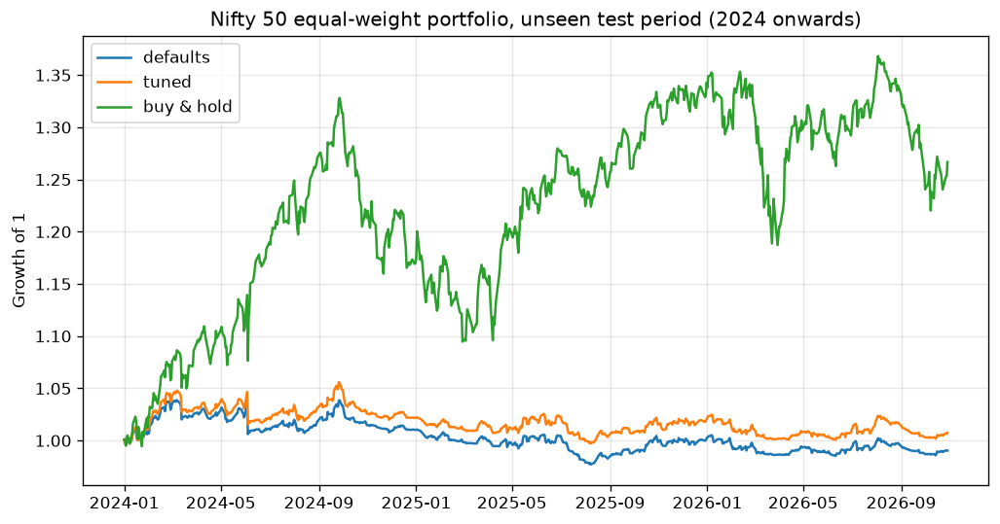

# Automated Trading Strategy

A modular Python framework for designing, backtesting and (eventually) live-trading systematic strategies.

## Strategy: DMI + MACD trend following

| Role | Indicator | Long rule (shorts mirror it) |
|---|---|---|
| Main | DMI (14, 14) | +DI above −DI, and ADX rising |
| Trigger and grade | MACD (12, 26, 9) | MACD line crosses above signal within the last 5 bars |
| Trend filter | EMA 20 / EMA 50 | Close above both EMAs |
| Exit | DMI / EMA 20 | −DI crosses above +DI, or close falls below EMA 20 |

Each MACD crossover is graded by where it happens:

- **Super strong**: above the zero line
- **Strong**: near the zero line (within 0.5% of price)
- **Normal**: below the zero line

`min_strength` in the config picks the lowest grade to trade. Indicator values match TradingView's built-in DMI, MACD and Stochastic.

Every threshold lives in [`config/config.yaml`](config/config.yaml).

## Research: does it hold up on Nifty 50?

[`research/nifty50_study.py`](research/nifty50_study.py) runs the strategy on 49 Nifty 50 stocks as an equal-weight portfolio, with costs included. The data is split in two:

- **Train, 2018–2023:** 54 parameter combinations, covering ADX floor, minimum MACD grade, exit EMA and crossover lookback.
- **Test, 2024–Oct 2026:** the best training settings run on years the search never saw.

| Period | Model | CAGR | Sharpe | Max drawdown | Time in market |
|---|---|---|---|---|---|
| Train | Defaults | 5.2% | 1.20 | −7.9% | 25% |
| Train | Tuned (exit EMA 50) | 7.0% | 1.37 | −8.4% | 30% |
| Train | Buy & hold | 22.4% | 1.19 | −38.3% | 100% |
| **Test** | Defaults | −0.3% | −0.08 | −5.9% | 23% |
| **Test** | Tuned | 0.3% | 0.09 | −5.6% | 26% |
| **Test** | Buy & hold | 8.9% | 0.68 | −17.6% | 100% |



**Findings**

- From 2018 to 2023 the strategy matched buy-and-hold on risk-adjusted return, with a quarter of the drawdown.
- That edge did not carry into 2024–2026, where it went roughly flat.
- Tuning helped only a little, and slower exits (EMA 50) worked better than fast ones in both periods.
- Large caps trend less cleanly than the midcap momentum names the rules were designed on, so the next step is a broader universe.

Caveat: this uses today's Nifty 50 list, so earlier years carry survivorship bias.

## Daily scanner

```bash
python scan.py                      # watchlist from config
python scan.py BSE.NS LUPIN.NS      # or any symbols
```

Prints +DI, −DI, ADX, the MACD grade and today's action (BUY / EXIT / HOLD) for each stock.

## Features

- **Pluggable strategies** — subclass `Strategy`, implement `generate_signals`, register it.
- **Vectorised backtester** — next-bar execution (no look-ahead), commission and slippage.
- **Metrics** — total return, CAGR, Sharpe, max drawdown, trade count.
- **Risk manager** — position sizing and stop-loss levels.
- **Broker interface** — paper broker now; live broker adapters plug into the same API.
- **Config-driven** — symbol, dates, strategy params and costs live in `config/config.yaml`.
- **Tested** — pytest suite run on every push via GitHub Actions.

## Project structure

```
src/trading/
  indicators.py DMI/ADX, MACD, EMA, Stochastic (TradingView-compatible)
  data/         market data loaders (Yahoo Finance, CSV)
  strategies/   Strategy base class + implementations
  backtest/     engine and performance metrics
  risk/         position sizing, stops
  broker/       broker interface, paper broker
config/         run configuration
tests/          unit tests
notebooks/      research
```

## Quick start

```bash
python -m venv .venv
.venv\Scripts\activate        # Windows  (source .venv/bin/activate on macOS/Linux)
pip install -r requirements.txt
python run_backtest.py
pytest -q
```

## Adding a strategy

1. Create `src/trading/strategies/my_strategy.py` subclassing `Strategy`.
2. Add it to `REGISTRY` in `src/trading/strategies/__init__.py`.
3. Set `strategy.name` and `params` in `config/config.yaml`.

## Roadmap

- [x] DMI + MACD strategy and daily scanner
- [ ] Use Stochastic (14, 3, 3) as an entry filter
- [x] Train/test validation on Nifty 50
- [ ] Test on midcap / smallcap universe
- [ ] Rolling walk-forward validation
- [ ] Equity curve and trade reports
- [ ] Live broker adapter
- [ ] Scheduling and alerts

## Disclaimer

For research and educational purposes. Not financial advice. Trading involves risk of loss.
