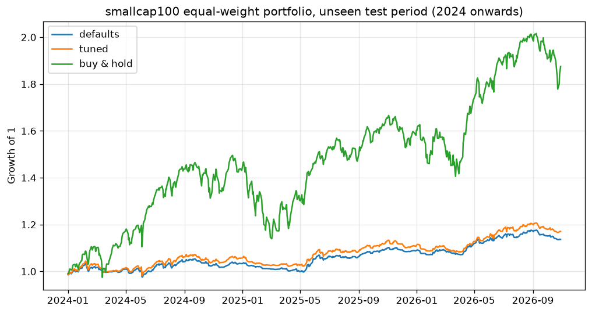

# Automated Trading Strategy

A modular Python framework for designing, backtesting and (eventually) live-trading systematic strategies.

## Strategy: DMI + MACD trend following

| Role | Indicator | Long rule (shorts mirror it) |
|---|---|---|
| Main | DMI (14, 14) | +DI above −DI, and ADX rising |
| Trigger and grade | MACD (12, 26, 9) | MACD line crosses above signal within the last 5 bars |
| Trend filter | EMA 20 / EMA 50 | Close above both EMAs |
| Exit | DMI / EMA 50 | −DI crosses above +DI, or close falls below EMA 50 (tuned; the original rule used EMA 20) |

Each MACD crossover is graded by where it happens:

- **Super strong**: above the zero line
- **Strong**: near the zero line (within 0.5% of price)
- **Normal**: below the zero line

`min_strength` in the config picks the lowest grade to trade. Indicator values match TradingView's built-in DMI, MACD and Stochastic.

Every threshold lives in [`config/config.yaml`](config/config.yaml).

## Research: does it hold up on Nifty 50?

[`research/index_study.py`](research/index_study.py) runs the strategy on every stock in an NSE index as an equal-weight portfolio, with costs included. The data is split in two:

- **Train, 2018–2023:** 54 parameter combinations, covering ADX floor, minimum MACD grade, exit EMA and crossover lookback.
- **Test, 2024–Oct 2026:** the best training settings run on years the search never saw.

```bash
python research/index_study.py --universe nifty50      # or midcap100, smallcap100
```

### Unseen test period (2024–Oct 2026)

| Universe | Model | CAGR | Sharpe | Max drawdown | Time in market |
|---|---|---|---|---|---|
| Nifty 50 | Defaults | −0.5% | −0.12 | −6.4% | 23% |
| Nifty 50 | Tuned | −0.1% | −0.01 | −6.4% | 26% |
| Nifty 50 | Buy & hold | 10.8% | 0.79 | −16.4% | 100% |
| Midcap 100 | Defaults | 2.2% | 0.47 | −4.7% | 23% |
| Midcap 100 | Tuned | 3.5% | 0.64 | −4.8% | 27% |
| Midcap 100 | Buy & hold | 14.9% | 0.84 | −20.5% | 100% |
| Smallcap 100 | Defaults | 4.7% | 0.89 | −5.7% | 25% |
| Smallcap 100 | Tuned | 5.8% | 0.94 | −5.9% | 30% |
| Smallcap 100 | Buy & hold | 25.4% | 1.16 | −23.8% | 100% |

### Training period (2018–2023)

| Universe | Defaults Sharpe | Tuned Sharpe | Buy & hold Sharpe | Strategy max DD | Buy & hold max DD |
|---|---|---|---|---|---|
| Nifty 50 | 1.39 | 1.55 | 1.27 | −7.6% | −38.5% |
| Midcap 100 | 1.47 | 1.54 | 1.19 | −7.4% | −40.0% |
| Smallcap 100 | 1.77 | 1.85 | 1.12 | −9.6% | −60.6% |



More charts: [Nifty 50](docs/test_equity_nifty50.png) · [Midcap 100](docs/test_equity_midcap100.png)

**Findings**

- **The smaller the stocks, the better it works.** On unseen data, Sharpe goes from 0 on Nifty 50, to 0.6 on midcaps, to 0.9 on smallcaps. Momentum names trend more cleanly, which matches the charts the rules came from.
- **It cuts risk sharply.** Worst drawdown stayed under 6% in every test, against 16–24% for buy-and-hold.
- **It does not beat buy-and-hold.** Raw return is far lower, because capital sits idle about 75% of the time, and even risk-adjusted it trails in 2024–2026.
- **The training edge shrank on new data.** In 2018–2023 it beat buy-and-hold on Sharpe in every universe. In 2024–2026 it fell behind, so part of that early edge was period-specific.
- **Tuning is stable.** The search kept choosing the same things on every universe: no ADX floor, accept all MACD grades, slower exits (EMA 50 or a DI cross only). Each of those gave a small, consistent gain.

Caveat: these are today's index members, so earlier years carry survivorship bias.

## Daily scanner

```bash
python scan.py                      # watchlist from config
python scan.py BSE.NS LUPIN.NS      # or any symbols
```

Prints +DI, −DI, ADX, the MACD grade and today's action (BUY / EXIT / HOLD) for each stock.

## Features

- **Pluggable strategies** — subclass `Strategy`, implement `generate_signals`, register it.
- **Vectorised backtester** — next-bar execution (no look-ahead), commission and slippage.
- **Metrics** — total return, CAGR, Sharpe, max drawdown, trade count.
- **Risk manager** — position sizing and stop-loss levels.
- **Broker interface** — paper broker now; live broker adapters plug into the same API.
- **Config-driven** — symbol, dates, strategy params and costs live in `config/config.yaml`.
- **Tested** — pytest suite run on every push via GitHub Actions.

## Project structure

```
src/trading/
  indicators.py DMI/ADX, MACD, EMA, Stochastic (TradingView-compatible)
  data/         market data loaders (Yahoo Finance, CSV)
  strategies/   Strategy base class + implementations
  backtest/     engine and performance metrics
  risk/         position sizing, stops
  broker/       broker interface, paper broker
config/         run configuration
tests/          unit tests
notebooks/      research
```

## Quick start

```bash
python -m venv .venv
.venv\Scripts\activate        # Windows  (source .venv/bin/activate on macOS/Linux)
pip install -r requirements.txt
python run_backtest.py
pytest -q
```

## Adding a strategy

1. Create `src/trading/strategies/my_strategy.py` subclassing `Strategy`.
2. Add it to `REGISTRY` in `src/trading/strategies/__init__.py`.
3. Set `strategy.name` and `params` in `config/config.yaml`.

## Roadmap

- [x] DMI + MACD strategy and daily scanner
- [ ] Use Stochastic (14, 3, 3) as an entry filter
- [x] Train/test validation on Nifty 50, Midcap 100, Smallcap 100
- [ ] Rolling walk-forward validation
- [ ] Equity curve and trade reports
- [ ] Live broker adapter
- [ ] Scheduling and alerts

## Disclaimer

For research and educational purposes. Not financial advice. Trading involves risk of loss.
