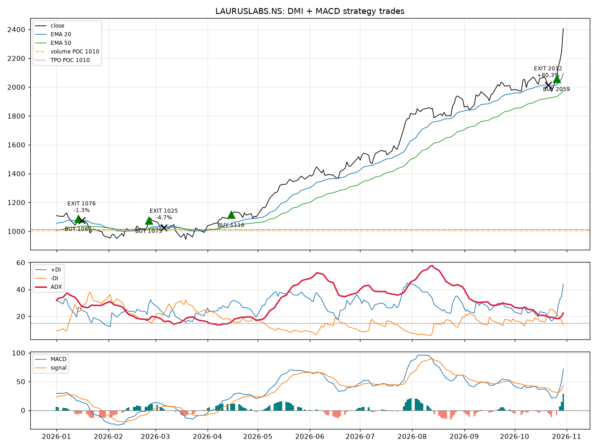

# Automated Trading Strategy

A modular Python framework for designing, backtesting and (eventually) live-trading systematic strategies.

## Strategy: DMI + MACD trend following

Daily candles. A signal forms at the close. One position at a time. ✅ on in [`config/config.yaml`](config/config.yaml), ⚪ in the code but off.

### Buy entry
All four must hold, plus a MACD pattern (rule 12):

1. ✅ **+DI above −DI** (DMI 14, 14 is the main indicator)
2. ✅ **ADX at least 15 and rising**
3. ✅ **MACD (12, 26, 9) above its signal line.** The last crossover is graded: above zero is super strong, near zero is strong, below zero is normal.
4. ✅ **Close above EMA 20 and EMA 50**

Re-entries, which skip the ADX and MACD checks because the trend is already established:

5. ✅ **+DI cross:** in an uptrend, +DI crosses back above −DI
6. ✅ **EMA 20 reclaim:** the pullback held EMA 50, and the close moves back above EMA 20
7. ✅ **EMA 20 bounce:** the low comes within 2% of EMA 20, then the close tops the previous high
8. ✅ **1-hour EMA cross:** while flat and the daily trend is intact, the 1-hour EMA 20 crosses above EMA 50 (enters during the day, not at the close)

Optional:

9. ⚪ **Accumulation breakout:** 60 days inside a range no wider than 25%, then a close above it on 1.5× volume
10. ⚪ **POC retest:** after breaking above the value area, price bounces off the volume POC
11. ⚪ **POC filter:** buy only above POC
12. ✅ **MACD pattern required:** a double dip or divergence must be present for the main entry (re-entries skip it)

### Sell entry (⚪ off, since positional shorts need futures)
The buy rules mirrored. Every sell entry, re-entries included, needs **ADX at least 15 and rising**.

### Exit
- ✅ **Long:** the close falls below EMA 50
- ✅ **Short:** the close rises above EMA 50
- ⚪ **Divergence exit:** exit a long on a new bearish MACD divergence (`exit_on_divergence`; off, because it cut winners short on all three indices)
- ⚪ **DI exit:** also exit on the opposite DI cross (`exit_on_di_cross`; off, because exiting on EMA 50 alone did better on unseen data)

### Shown in the scanner
- MACD double dip / double top, regular and hidden divergence, confirmed without lookahead
- Accumulation range ("in base") and breakouts
- Volume profile: POC, value area, estimated buyer share
- Market Profile (TPO) POC

Indicator values match TradingView's built-in DMI, MACD and Stochastic.

## Worked example: Laurus Labs, 2026

```bash
python research/trade_example.py LAURUSLABS.NS --start 2026-01-01
```

| Entry | Why | Exit | Why | Return |
|---|---|---|---|---|
| 25 Feb, ₹1,075 | Trend entry: ADX 17.8 rising, +DI 28.8 vs −DI 16.5, MACD bullish with a pattern | 9 Mar, ₹1,020 | Close below EMA 50 | −5.1% |
| **23 Apr, ₹1,128** | **EMA 20 pullback rejected: ADX 19.3, +DI 26.5 vs −DI 17.5** | **open** | Price never closed below EMA 50 | **+113.3%** |



The pattern is typical of trend following: small losses while no trend forms, then one trade that rides the whole move. The same script on Nifty Pharma gives 4 trades and +10.0%, with the 29 Apr to 15 Sep trade making +12.6% ([chart](docs/example_cnxpharma.png)).

## Research

All studies run every stock in an NSE index as an equal-weight portfolio, with costs. Rules are judged on two periods:

- **Train:** 2018–2023
- **Test:** 2024–Oct 2026, unseen while the rules were built

### Current rules vs buy and hold

| Universe | Test CAGR | Test Sharpe | Test max DD | Buy & hold Sharpe | Buy & hold max DD |
|---|---|---|---|---|---|
| Smallcap 100 | 8.7% | 1.01 | −8.2% | 1.16 | −23.8% |
| Midcap 100 | 3.8% | 0.51 | −8.6% | 0.84 | −20.5% |
| Nifty 50 | 0.5% | 0.11 | −8.4% | 0.79 | −16.4% |

The strategy works best on smallcaps and keeps drawdowns to roughly a third of buy-and-hold. It still trails buy-and-hold on the test years, partly because capital sits idle more than half the time.

### Which rules earn their place?

[`research/rule_ablation.py`](research/rule_ablation.py) flips one rule at a time. The table shows the change in **test-period Sharpe** against the current config.

| Change | Smallcap | Midcap | Nifty 50 | Verdict |
|---|---|---|---|---|
| Remove +DI cross re-entry | −0.12 | −0.16 | −0.16 | Keep it: the most valuable rule |
| Exit on EMA 50 only (no DI exit) | +0.08 | +0.21 | +0.37 | Strongest improvement |
| Require MACD pattern | +0.08 | +0.09 | +0.04 | Helps everywhere, and lowers drawdown |
| ADX floor 15 → 0 | +0.03 | +0.07 | +0.04 | Small, consistent gain |
| Skip re-entries inside a base | +0.03 | −0.02 | +0.08 | Mixed |
| POC filter | −0.03 | +0.10 | −0.01 | Mixed |
| POC retest entry | +0.03 | 0.00 | 0.00 | No clear effect |
| Accumulation breakout entry | 0.00 | −0.01 | 0.00 | No clear effect |
| Remove EMA 20 reclaim / bounce | ~0 | ~0 | ~0 | Overlaps the +DI cross |
| Exit on new bearish MACD divergence | −0.06 | −0.08 | −0.08 | Off: exits too early in strong trends |
| Allow shorts | −1.10 | −0.73 | −0.83 | Keep shorts off |

### 1-hour re-entries

[`research/hourly_reentry_study.py`](research/hourly_reentry_study.py) keeps the daily entries and exits, and lets a flat position re-enter on a 1-hour trigger while the daily trend is intact. Yahoo keeps about two years of hourly data, so this covers 2024 onwards only.

| Universe | Daily only | 1h +DI cross | 1h EMA 20/50 cross | Either |
|---|---|---|---|---|
| Smallcap 100 | 9.9%, Sharpe 1.19 | 10.9%, 1.21 | 10.7%, 1.22 | 11.3%, 1.23 |
| Midcap 100 | 6.6%, 0.90 | 7.2%, 0.93 | 7.2%, 0.94 | 7.2%, 0.91 |
| Nifty 50 | 2.0%, 0.33 | 2.2%, 0.35 | 2.8%, 0.44 | 2.7%, 0.42 |

Hourly re-entries helped on every index. The EMA 20/50 cross gave the best Sharpe with the smallest rise in drawdown, so it is the one switched on. With only two years of hourly data there is no separate unseen period, so treat this gain as provisional.

```bash
python research/rule_ablation.py --universe smallcap100   # or midcap100, nifty50
python research/hourly_reentry_study.py --universe smallcap100
python research/index_study.py --universe smallcap100     # parameter grid search
```

Caveat: these are today's index members, so earlier years carry survivorship bias. Daily bars approximate the volume and market profiles; TradingView uses intraday data.

## Daily scanner

```bash
python scan.py                      # watchlist from config
python scan.py BSE.NS LUPIN.NS      # or any symbols
```

Prints +DI, −DI, ADX, POC, buyer share, the MACD grade, patterns and today's action (BUY / EXIT / HOLD) for each stock.

## Features

- **Pluggable strategies** — subclass `Strategy`, implement `generate_signals`, register it.
- **Vectorised backtester** — next-bar execution (no look-ahead), commission and slippage.
- **Metrics** — total return, CAGR, Sharpe, max drawdown, trade count.
- **Risk manager** — position sizing and stop-loss levels.
- **Broker interface** — paper broker now; live broker adapters plug into the same API.
- **Config-driven** — symbol, dates, strategy params and costs live in `config/config.yaml`.
- **Tested** — pytest suite run on every push via GitHub Actions.

## Project structure

```
src/trading/
  indicators.py DMI/ADX, MACD, EMA, Stochastic, volume and market profile
  data/         market data loaders (Yahoo Finance, CSV)
  strategies/   Strategy base class + implementations
  backtest/     engine and performance metrics
  risk/         position sizing, stops
  broker/       broker interface, paper broker
config/         run configuration
research/       index studies, rule ablation, worked trade example
docs/           charts
tests/          unit tests
```

## Quick start

```bash
python -m venv .venv
.venv\Scripts\activate        # Windows  (source .venv/bin/activate on macOS/Linux)
pip install -r requirements.txt
python run_backtest.py
pytest -q
```

## Adding a strategy

1. Create `src/trading/strategies/my_strategy.py` subclassing `Strategy`.
2. Add it to `REGISTRY` in `src/trading/strategies/__init__.py`.
3. Set `strategy.name` and `params` in `config/config.yaml`.

## Roadmap

- [x] DMI + MACD strategy and daily scanner
- [ ] Use Stochastic (14, 3, 3) as an entry filter
- [x] Train/test validation on Nifty 50, Midcap 100, Smallcap 100
- [ ] Rolling walk-forward validation
- [x] Per-trade reports with entry and exit reasons
- [ ] Live broker adapter
- [ ] Scheduling and alerts

## Disclaimer

For research and educational purposes. Not financial advice. Trading involves risk of loss.
